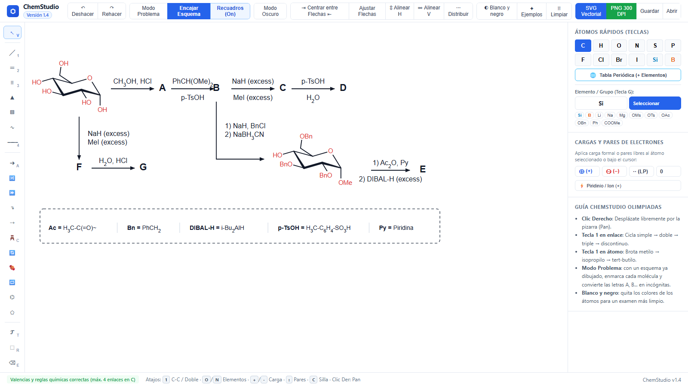

# ChemStudio ⬡

> **Editor químico web para esquemas de reacción y problemas de Olimpiadas de Química**

ChemStudio sirve para dibujar rutas sintéticas de química orgánica y convertirlas en problemas de olimpiada: conformaciones de silla, flechas con reactivos, recuadros de incógnitas (A, B, C…), recuadro de abreviaturas y validación de valencias en tiempo real. Funciona entero en el navegador, sin instalar nada.

### **[▶ Probar ChemStudio en línea](https://adma2.github.io/chemstudio/)**



---

## Cómo usarlo

**En línea:** entra en [adma2.github.io/chemstudio](https://adma2.github.io/chemstudio/). Cada persona trabaja con su propia copia en su navegador; para conservar un dibujo, usa **Guardar** (JSON) o exporta a SVG/PNG.

**En tu ordenador:** descarga el repositorio y abre `index.html` en Chrome, Edge o Firefox. También puedes, con Python instalado, ejecutar un servidor local: con Python instalado, ejecuta un servidor local:
```bash
python server.py
```
Se abrirá el navegador en `http://localhost:8080/index.html`.

---

## Características

### Dibujo de moléculas
- Enlaces de **longitud fija** con ajuste a ángulos de 30°.
- **Clic en un enlace**: cicla entre simple → doble → triple → cuña sólida → cuña a trazos → ondulado.
- **Etiquetas automáticas**: los heteroátomos muestran sus hidrógenos según sus enlaces (`OH`, `NH2`, `O`, `N`…) y se colocan del lado correcto (`HO–` / `–OH`).
- **Cargas formales automáticas** en amonio, nitro, piridinio, oxonio, etc.
- **Plantillas de anillos**: benceno, ciclohexano y ciclopentano; se fusionan al hacer clic sobre un enlace (naftaleno, fenantreno…).
- **Grupos y protectores rápidos**: OMs, OTs, OAc, OBn, Ph, COOMe, TBDPS…

### Conformaciones de silla
- Silla de **ciclohexano** y de **piranosa** con el modelo de los exámenes IChO (borde frontal remarcado).
- Al hacer clic en un vértice o al trazar un enlace desde él, el sustituyente sigue la dirección **axial** o **ecuatorial** libre.
- Tecla `C` alterna entre silla normal y giro de silla.

### Flechas y esquemas de reacción
- Flechas de cualquier longitud con ajuste a 0°, 45°, 90°…
- Flechas de **bifurcación**, **convergencia**, **doblada en L** y **punteada**.
- **Reactivos arriba y abajo** de la flecha, con subíndices automáticos (`H2O` → H₂O) y numeración (`1) NaH, BnCl`).
- Se puede dibujar una **molécula sobre la flecha** (p. ej. un dieno para Diels-Alder).
- **Encajar Esquema**, **Centrar entre Flechas**, **Alinear** y **Distribuir** para ordenar el dibujo.

### Modo Problema
- Enmarca cada molécula de la ruta en un recuadro y convierte las letras sueltas en **incógnitas** (A, B, C…), siguiendo el orden de las flechas.
- **Recuadro de referencias** punteado (tecla `R`) para definir abreviaturas: `Ac = H3C-C(=O)~ | Bn = PhCH2 | Py = Piridina`.

### Validación química
- Marca en rojo los átomos con más enlaces de los permitidos (p. ej. un carbono con 5 enlaces) y avisa en la barra inferior.

### Exportación
- **SVG vectorial** para Word, LaTeX, Inkscape o Illustrator.
- **PNG a 300 DPI** para imprimir.
- **Guardar / Abrir** proyectos en formato JSON.
- **Modo oscuro** y **modo blanco y negro** para exámenes.
- Galería de **ejemplos** listos para cargar.

---

## Atajos de teclado

Con el cursor sobre un átomo (o con átomos seleccionados):

| Tecla | Acción |
|---|---|
| `1` | Brota un enlace: metilo → isopropilo → terc-butilo |
| `C`, `O`, `N`, `S`, `P`, `F`, `I`, `H` | Cambia el elemento |
| `L` / `B` / `K` | Cloro / Bromo / Silicio |
| `G` | Aplica el grupo escrito en el panel (OMs por defecto) |
| `+` / `-` / `0` | Sube, baja o restablece la carga formal |
| `:` | Añade pares de electrones libres |

Con el cursor sobre un enlace:

| Tecla | Acción |
|---|---|
| `1` | Cicla simple → doble → triple → discontinuo |
| `2` / `3` | Doble / triple |

Herramientas (sin el cursor sobre un átomo):

| Tecla | Herramienta |
|---|---|
| `V` o `S` | Seleccionar |
| `B` | Enlace |
| `A` | Flecha |
| `C` | Silla |
| `T` | Texto |
| `R` | Recuadro de referencias |
| `E` | Borrador |
| `Ctrl+Z` / `Ctrl+Y` | Deshacer / Rehacer |
| `Supr` | Borrar la selección |
| Clic derecho + arrastrar | Desplazar el lienzo |
| Rueda del ratón | Zoom |

---

## Para desarrolladores

El código fuente está en `js/` (módulos ES). La página carga `js/bundle.js`, que une todos los módulos para que funcione también abriendo el archivo sin servidor. **No edites `bundle.js` a mano**: después de cambiar algo en `js/`, regenéralo con:

```bash
node build_bundle.mjs
```

Tests (requieren Node.js):

```bash
node test/chem_tests.mjs
node test/test_dark_mode.mjs
```

---

## Licencia

[MIT](LICENSE) © Ángel Munguía
